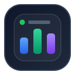
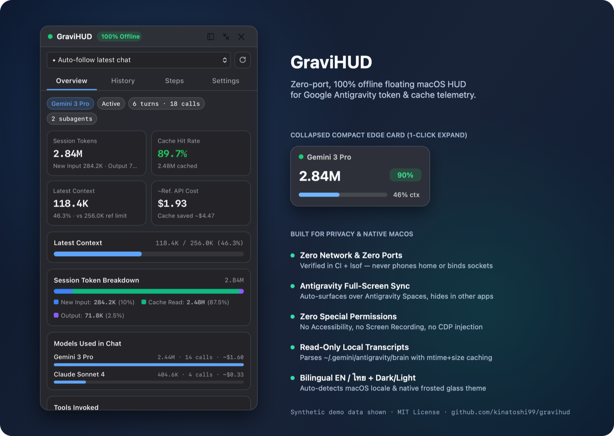

<p align="center">
  
</p>

<h1 align="center">GraviHUD</h1>

<p align="center">
  <strong>A 100% offline, zero-port native macOS floating HUD for Google Antigravity token, cache, and context telemetry.</strong>
</p>

<p align="center">
  <a href="https://github.com/kinatoshi99/gravihud/actions/workflows/ci.yml"></a>
  <a href="https://github.com/kinatoshi99/gravihud/releases"></a>
  
  
  
  <a href="LICENSE"></a>
</p>

<p align="center">
  <strong>English</strong> · <a href="README.th.md">ภาษาไทย (Thai)</a> · <a href="SECURITY.md">Security Model</a> · <a href="CHANGELOG.md">Changelog</a>
</p>

<p align="center">
  
</p>

---

## Why GraviHUD?

Most usage-monitor hacks rely on injecting scripts into Electron windows via remote debugging (CDP), reading private SQLite databases, querying undocumented internal RPCs, or bundling auto-updaters that phone home.

**GraviHUD takes the opposite approach:**

- **100% Offline & Zero Open Ports:** No `URLSession`, no `fetch()`, no localhost server, no auto-updater, and zero network sockets (verified statically in CI and at runtime with `lsof`).
- **Zero Antigravity Modification:** Runs as a standalone native macOS floating `NSPanel` — never touches Antigravity's app bundle, shortcuts, memory, or credentials.
- **Zero Special Permissions:** No Accessibility permission and no Screen Recording permission required.
- **Read-Only Local Parsing:** Reads only documented local conversation transcripts at `~/.gemini/antigravity/brain/<uuid>/.system_generated/logs/transcript.jsonl` with an `mtime + size` cache for near-zero idle CPU.

---

## Features

- **Antigravity-Aware Auto-Visibility (Default ON):** Automatically surfaces whenever **Antigravity** is focused — including **macOS Native Full-Screen Spaces** — and hides cleanly when you switch to any other app. (Can also be switched to *Float over all apps*.)
- **Non-Activating Floating Panel:** Click tabs, inspect steps, or collapse the HUD without stealing keyboard focus from your Antigravity prompt input.
- **Compact Edge Card ↔ Full 4-Tab Drawer:**
  - **Compact Card (`196 × 86`):** Frosted-glass edge pill showing active model, total tokens, cache hit %, and a live context meter bar. Drag along either screen edge or click once to expand.
  - **Overview Tab:** Session tokens, Cache Hit %, latest Context usage vs configurable reference limit (`200K / 256K / 512K / 1M`), offline reference API cost & cache savings, token breakdown bar (Input / Cache / Output), per-model summary, and tools invoked.
  - **History Tab:** `Today / 7D / 30D / All` interactive stacked bar trend chart, model rankings, and quick-switch recent local chats.
  - **Steps Tab:** Searchable per-step inspector with Input / Cache / Output / Total tokens, timing gaps, thinking/subagent badges, and tool chips.
  - **Settings Tab:** Floating mode & edge dock, **English / ไทย (Thai)** language switch (auto-detected from macOS locale), font size, accent colors, full vs short model names, context meter reference limit, and built-in security audit card.
- **Auto-Follows Active Chat:** Automatically tracks the most recently updated conversation as you switch chats, or lets you pin any historical chat from the dropdown.
- **Native macOS Polish:** Automatic Light/Dark frosted glass (`NSVisualEffectView`), Menu Bar icon (`LSUIElement` — zero Dock clutter), native `AppIcon.icns`, Universal binary (`arm64` + `x86_64`), and single-instance reopen handling.

---

## Install & Run

### Option 1 — Build Locally from Source *(Recommended · Zero Gatekeeper Prompts)*

Requires **macOS 13.0+** and Apple Command Line Tools (`swiftc`). Zero external packages needed:

```bash
git clone https://github.com/kinatoshi99/gravihud.git
cd gravihud
chmod +x build.sh
./build.sh --install --run
```

*(Use `./build.sh --run` to run directly from `build/GraviHUD.app` without copying to `/Applications`, or `./build.sh --universal` to compile a Universal `arm64 + x86_64` binary.)*

### Option 2 — Download Prebuilt Universal Binary (GitHub Releases)

1. Download `GraviHUD-v1.0.0-macos-universal.zip` and `SHA256SUMS.txt` from [GitHub Releases](https://github.com/kinatoshi99/gravihud/releases).
2. Verify checksum & clear macOS browser quarantine (since this free open-source release is ad-hoc signed, not Apple-notarized):
   ```bash
   shasum -a 256 -c SHA256SUMS.txt
   unzip GraviHUD-v1.0.0-macos-universal.zip
   xattr -cr GraviHUD.app
   open GraviHUD.app
   ```

### Optional: Auto-Start Quietly at macOS Login (Opt-In LaunchAgent)

Starts GraviHUD in your Menu Bar at login so the floating HUD appears automatically whenever you open Antigravity:

```bash
chmod +x scripts/install-login-item.sh
./scripts/install-login-item.sh
```

Remove the login item at any time:

```bash
./scripts/install-login-item.sh --uninstall
```

---

## Verify Zero-Network Security Yourself

Every commit and Pull Request runs [scripts/security-audit.sh](scripts/security-audit.sh) in GitHub Actions CI. You can audit both the source and the live running binary yourself:

```bash
# 1. Static source audit (must report PASS)
./scripts/security-audit.sh

# 2. Live runtime socket check (must return zero lines)
PID=$(pgrep -x GraviHUD | head -n 1)
lsof -nP -i -a -p "$PID"
```

See [SECURITY.md](SECURITY.md) for the full security model and file boundaries.

---

## Intentional Limitations

To preserve strict offline safety and zero-hacking guarantees:

- **No 5-hour / weekly account quota percentages:** Quota state is not stored in local `transcript.jsonl` files, and GraviHUD intentionally refuses to read credentials or call undocumented backend RPCs.
- **Offline reference cost estimates:** USD cost figures and cache savings are calculated locally from a static rate table in [Sources/Pricing.swift](Sources/Pricing.swift) for intuition only — not real billing or quota deduction.
- **macOS only:** Built natively on AppKit (`NSPanel`, `NSVisualEffectView`, `NSWorkspace`) and `WKWebView`.

---

## Project Structure

```text
gravihud/
├── Sources/
│   ├── AppMain.swift                 # @main entry, accessory app policy, single-instance guard
│   ├── FloatingPanelController.swift # Non-activating NSPanel, Full-Screen Space sync, Compact card, Menu Bar
│   ├── WebUI.swift                   # Strictly offline WKWebView + Base64 in-memory IPC bridge
│   ├── TranscriptParser.swift        # Read-only transcript.jsonl scanner with mtime+size cache
│   ├── Pricing.swift                 # Static offline reference USD/1M rate table & model name formatter
│   ├── SettingsStore.swift           # Validated JSON preferences (~/Library/Application Support/GraviHUD)
│   └── Models.swift                  # Codable data models
├── Resources/
│   └── panel.html                    # Self-contained zero-network 4-tab UI (strict CSP)
├── Tests/
│   └── run_tests.swift               # 8 deterministic Swift unit tests (zero external test dependencies)
├── scripts/
│   ├── generate-icon.swift           # Pure CoreGraphics macOS AppIcon generator
│   ├── security-audit.sh             # Static zero-network / zero-shell / zero-credential verifier
│   ├── install-login-item.sh         # Opt-in per-user macOS LaunchAgent installer/uninstaller
│   └── release-notes.sh              # Release notes generator for CI
├── .github/workflows/
│   ├── ci.yml                        # macOS CI: audit + 8 unit tests + Universal build
│   └── release.yml                   # Automated Universal release zip + SHA-256 checksums on v* tags
├── build.sh                          # Standalone .app bundle builder (--universal / --install / --run / --zip)
├── SECURITY.md
├── CONTRIBUTING.md
├── CHANGELOG.md
└── LICENSE
```

---

## Uninstall

1. Quit **GraviHUD** from its Menu Bar icon.
2. If you enabled auto-start: `./scripts/install-login-item.sh --uninstall`
3. Delete `GraviHUD.app` (from `build/` or `/Applications/`) and optionally remove saved preferences:
   ```bash
   rm -rf "$HOME/Library/Application Support/GraviHUD"
   ```

---

## License

Released under the [MIT License](LICENSE). Free to use, audit, fork, and modify.
