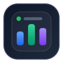
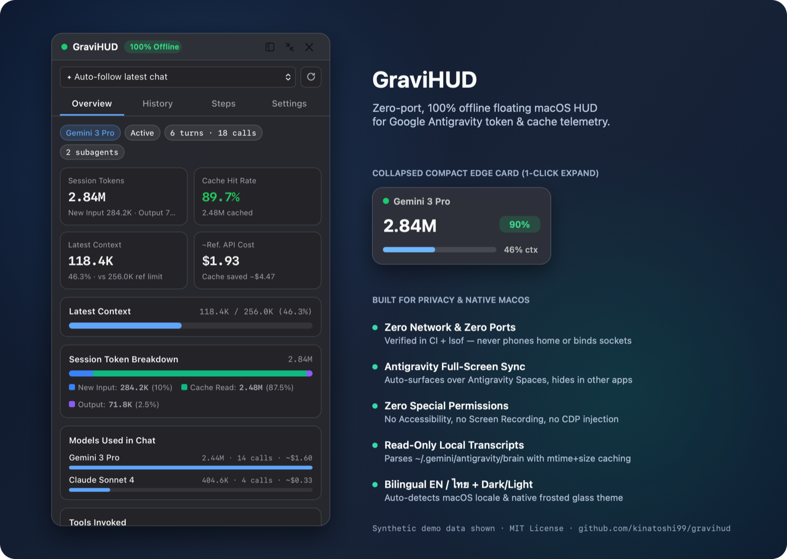

<p align="center">
  
</p>

<h1 align="center">GraviHUD</h1>

<p align="center">
  <strong>แผงลอยด้านข้างสำหรับ macOS แบบออฟไลน์ 100% ไม่เปิดพอร์ตเครือข่าย สำหรับดูสถิติโทเคน แคช และความจำ Context ของ Google Antigravity</strong>
</p>

<p align="center">
  <a href="README.md">English</a> · <strong>ภาษาไทย</strong> · <a href="SECURITY.md">นโยบายความปลอดภัย</a> · <a href="CHANGELOG.md">Changelog</a>
</p>

<p align="center">
  
</p>

---

## ทำไมต้อง GraviHUD?

เครื่องมือดูสถิติหลายตัวใช้วิธีเจาะหน้าต่าง Electron (เปิดโหมดนักพัฒนา CDP), อ่านไฟล์ฐานข้อมูลภายใน, ยิงคำสั่งหลังบ้านที่ไม่ได้เปิดเป็นทางการ หรือแฝงระบบอัปเดตอัตโนมัติที่ต่ออินเทอร์เน็ต

**GraviHUD ออกแบบตรงกันข้ามเพื่อความสบายใจสูงสุด:**

- **ออฟไลน์ 100% และไม่เปิดพอร์ตเครือข่ายเลย (Zero Network & Zero Ports):** ไม่มี `URLSession`, ไม่มี `fetch()`, ไม่มีเซิร์ฟเวอร์ localhost, ไม่มีตัวอัปเดตตัวเอง (ตรวจเช็กอัตโนมัติใน CI และเช็กตอนรันจริงด้วย `lsof` ได้)
- **ไม่แตะ ไม่เจาะ และไม่แทรกแซงแอป Antigravity:** ทำงานเป็นหน้าต่างแผงลอยอิสระของ macOS แท้ๆ (`NSPanel`)
- **ไม่ขอสิทธิ์พิเศษใดๆ ของ macOS:** ไม่ขอสิทธิ์ Accessibility และไม่ขอสิทธิ์อัดหน้าจอ (Screen Recording) และไม่อ่าน Keychain หรือบัญชี Google
- **อ่านอย่างเดียว (Read-only):** อ่านเฉพาะไฟล์บันทึกแชทมาตรฐาน `~/.gemini/antigravity/brain/<uuid>/.system_generated/logs/transcript.jsonl` พร้อมแคชตามเวลาแก้ไขไฟล์ กิน CPU เกือบ 0%

---

## ความสามารถเด่น

- **โผล่เฉพาะตอนใช้ Antigravity (ค่าเริ่มต้น):** เด้งแสดงอัตโนมัติทันทีที่เปิดหรือสลับมาหน้า Antigravity (รองรับโหมด **Full Screen ของ macOS** เต็มรูปแบบ) และซ่อนตัวเองทันทีเมื่อสลับไปแอปอื่น (เปลี่ยนเป็น *ลอยทุกแอป* ได้ในคลิกเดียว)
- **ไม่แย่งเคอร์เซอร์พิมพ์:** กดดูแท็บหรือพับแผงได้โดยไม่ดึงโฟกัสออกจากช่องพิมพ์แชท
- **สลับได้ 2 โหมดในคลิกเดียว — แถบจิ๋วติดขอบจอ ↔ แผงเต็ม 4 แท็บ:**
  - **แถบจิ๋ว (`196 × 86`):** โชว์ชื่อโมเดล ยอดโทเคนรวม % แคช และหลอด Context ลากเลื่อนขึ้น-ลงตามขอบซ้าย/ขวาได้ คลิก 1 ทีเพื่อกางเต็ม
  - **แท็บภาพรวม (Overview):** โทเคนรวม, อัตรา Cache Hit (%), ความจำ Context รอบล่าสุดเทียบเพดานอ้างอิง (`200K / 256K / 512K / 1M`), ~ค่า API อ้างอิง + ยอดประหยัดจากแคช, แถบสัดส่วนโทเคน (เข้าใหม่ / แคช / คำตอบ), รายการโมเดล และเครื่องมือที่ใช้
  - **แท็บประวัติ (History):** กราฟแนวโน้มแบบโต้ตอบได้ (`วันนี้ / 7 วัน / 30 วัน / ทั้งหมด`), อันดับโมเดล และรายการแชทล่าสุด
  - **แท็บทีละขั้น (Steps):** ค้นหาและไล่ดูรายละเอียดแต่ละรอบพร้อมชื่อเครื่องมือและระยะเวลาห่าง
  - **แท็บตั้งค่า (Settings):** สลับโหมดการแสดงผล, ย้ายขอบซ้าย/ขวา, สลับภาษา **ไทย / EN**, ปรับขนาดตัวอักษร, เลือกสีเน้น, ปรับเพดานอ้างอิง Context และดูการ์ดตรวจความปลอดภัย
- **รองรับทั้ง Apple Silicon และ Intel Mac (Universal Binary):** พร้อมไอคอนแอป native และควบคุมจาก Menu Bar ด้านบนของ Mac

---

## วิธีติดตั้งและใช้งาน

### วิธีที่ 1 — คอมไพล์จากโค้ดในเครื่องตัวเอง *(แนะนำ · ไม่ติด Gatekeeper)*

ใช้ **macOS 13.0+** และ Command Line Tools (`swiftc`) ไม่ต้องลงไลบรารีภายนอกเลย:

```bash
git clone https://github.com/kinatoshi99/gravihud.git
cd gravihud
chmod +x build.sh
./build.sh --install --run
```

### วิธีที่ 2 — ดาวน์โหลดไฟล์พร้อมใช้งานจาก GitHub Releases

1. ดาวน์โหลด `GraviHUD-v1.0.1-macos-universal.zip` และ `SHA256SUMS.txt` จากหน้า [GitHub Releases](https://github.com/kinatoshi99/gravihud/releases)
2. ตรวจสอบแฮช ปลดล็อก quarantine และติดตั้งลง `/Applications`:
   ```bash
   shasum -a 256 -c SHA256SUMS.txt
   unzip GraviHUD-v1.0.1-macos-universal.zip
   xattr -cr GraviHUD.app
   cp -R GraviHUD.app /Applications/
   open /Applications/GraviHUD.app
   ```

### (ตัวเลือก) ตั้งค่าบังคับเปิดอัตโนมัติทุกครั้งที่เปิดเครื่องและใช้งาน Antigravity

1. ให้รันรอเงียบๆ บน Menu Bar อัตโนมัติตั้งแต่เปิดเครื่อง (ใส่ `--keep-alive` เพื่อให้ macOS ปลุกกลับมาเองหากแอปถูกปิด):
   ```bash
   chmod +x scripts/install-login-item.sh
   ./scripts/install-login-item.sh --keep-alive
   ```
2. ผูก Global Hook ของ Antigravity (`SessionStart` + `PreInvocation` ใน `~/.gemini/config/hooks.json` แบบไม่กินโทเคนเพิ่ม) เพื่อบังคับปลุกแผงลอยทุกครั้งที่เริ่มแชทหรือส่งคำสั่งใน AGY:
   ```bash
   chmod +x scripts/install-agy-hook.sh
   ./scripts/install-agy-hook.sh
   ```

*(หากต้องการถอนการติดตั้งอัตโนมัติภายหลัง รัน `./scripts/install-login-item.sh --uninstall` และ `./scripts/install-agy-hook.sh --uninstall`)*

---

## วิธีตรวจความปลอดภัยด้วยตัวเอง

```bash
# 1. สแกนโค้ดทั้งหมดว่าไม่มีโค้ดออกเน็ต/รัน shell/อ่านรหัสผ่าน
./scripts/security-audit.sh

# 2. เช็กขณะรันจริงว่าไม่เปิดพอร์ตหรือต่อเน็ตใดๆ (ต้องไม่มีบรรทัดแสดงออกมา)
PID=$(pgrep -x GraviHUD | head -n 1)
lsof -nP -i -a -p "$PID"
```

---

## ข้อจำกัดที่ตั้งใจเว้นไว้เพื่อความปลอดภัย

- **ไม่แสดงเปอร์เซ็นต์โควต้าคงเหลือ 5 ชม. / รายสัปดาห์:** เพราะไม่มีในไฟล์ `transcript.jsonl` และแอปตั้งใจไม่ยุ่งกับบัญชีล็อกอินหรือหลังบ้านของ Antigravity
- **ค่าใช้จ่าย USD เป็นการประมาณการอ้างอิงแบบออฟไลน์เท่านั้น** (จากตารางราคาใน [Sources/Pricing.swift](Sources/Pricing.swift)) ไม่ใช่ยอดหักโควต้าจริง

---

## ลิขสิทธิ์

เผยแพร่ภายใต้สัญญาอนุญาต [MIT License](LICENSE) ใช้งานฟรี ตรวจสอบโค้ดและพัฒนาต่อได้อย่างอิสระ
